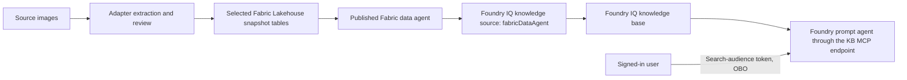

# Fabric IQ through a Foundry IQ knowledge base

The canonical integration blueprint for image-derived tables is:



The Foundry knowledge-source picker calls this family **Fabric IQ (OneLake
catalog)**. For a Lakehouse, the configuration represented here connects a
**Fabric data agent** to the knowledge base. This is different from uploading
relation cards to an Azure AI Search index. Ontology is a separate supported
source route and is not created by this exporter. Lakehouse tables alone do not
make either integration live.

## Local export

`sr_adapter.fabric_iq.export_fabric_iq` reads an existing `visual_tabular` export
through `verify_fabric`. It repeats the source/model-response replay, table
projection and byte checks before generating configuration. It does not send any
requests, publish a Fabric data agent, create a knowledge base, or prove cloud
connectivity.

```sh
sr-adapt knowledge fabric-iq verified-visual-export \
  --fabric-target fabric-target.json --foundry-target foundry-target.json \
  --retrieval-model kb-retrieval-model.json --out fabric-iq-handoff
```

This command is local only. Omit `--data-agent-id` until a real published Fabric
data agent exists; the resulting handoff records the missing configuration.

```python
from pathlib import Path

from sr_adapter.fabric import FabricTarget
from sr_adapter.fabric_iq import (
    FabricIQRetrievalModel, export_fabric_iq, verify_fabric_iq,
)
from sr_adapter.foundry import FoundryTarget

fabric_target = FabricTarget.model_validate_json(Path("fabric-target.json").read_bytes())
foundry_target = FoundryTarget.model_validate_json(Path("foundry-target.json").read_bytes())
retrieval_model = FabricIQRetrievalModel.model_validate_json(
    Path("kb-retrieval-model.json").read_bytes()
)

inputs = dict(
    fabric_export="verified-visual-export",
    fabric_target=fabric_target,
    foundry_target=foundry_target,
    # Supply a real, published data agent ID after provisioning and testing it.
    data_agent_id=None,
    retrieval_model=retrieval_model,
)
export_fabric_iq(destination="fabric-iq-handoff", **inputs)
verify_fabric_iq("fabric-iq-handoff", **inputs)
```

The retrieval model file contains `resource_uri`, `deployment_id`, and
`model_name`. The resource URI is an Azure OpenAI or Foundry resource origin;
deployment and model names are explicit, because a deployment may have a custom
name. This KB planning model is independent of `FoundryTarget.model_deployment`,
which selects the answering prompt agent's model. Neither file accepts keys or
tokens.

When `data_agent_id` or `retrieval_model` is missing, the export still provides a
reviewable blueprint with `configured: false`, an empty `operations` list and
explicit missing configuration. The missing data agent ID is `null`, never an
invented cloud identifier. Such a knowledge-source body is an incomplete template
and must not be submitted. Even when all inputs are present, the result remains
`prepared_only` and `execution_supported: false`.

| File | Meaning |
| --- | --- |
| `source-binding.json` | Full snapshot ID, original manifest hash, explicit target, selected table names, schemas, counts and row digests |
| `fabric-data-agent-definition.json` | InlineBase64 Fabric definition parts for the **draft** stage, source instructions and exact selected schema |
| `knowledge-source.json` | `fabricDataAgent` source, workspace and data agent IDs |
| `knowledge-base.json` | Dedicated KB with `low` reasoning effort and explicit planning model |
| `project-connection.json` | Project managed-identity connection to the KB MCP endpoint |
| `prompt-agent.json` | Prompt agent, candidate/evidence instructions and required per-user structured token input |
| `retrieval-request.json` | Sample question template requesting activity, references and reference source data |
| `deployment-plan.json` | Dependencies, authorization requirements and configured operation descriptions |
| `manifest.json` | File hashes and source binding; a local receipt, not a cloud publication receipt |

All outputs are deterministic and the destination must be new. Verification
regenerates every file from the original export and explicit parameters; merely
rehashing a modified blueprint cannot change the source selection, remove OBO,
or silently redirect the target. Source images, labels, findings and table rows
are not copied into these configuration files. Exported connection/resource IDs
and table metadata can still be sensitive; keep environment-specific handoffs
outside the public repository.

## Table and evidence semantics

Only nonempty tables from the exact verified snapshot are selected. The allowed
table kinds are `images`, `items`, `relations`, `evidence`, `limitations`, and
optional `reviews`. Names contain the full snapshot digest. Older snapshots and
unrelated Lakehouse tables are not selected. Empty tables have no published
counterpart and are omitted from the data-agent selection.

Generated instructions require joins on `package_id` plus exact occurrence IDs.
Matching labels do not resolve entities. In particular, a system name repeated
at two sites must not be merged automatically. Review references must also match
`reference_kind`; an image finding has a null reference ID and applies at image
scope.

`model_candidate_needs_review` flags a disputed candidate. It cannot become an
established fact because an agent can query the row. Unflagged candidates remain
unverified. The agent must preserve uncertain support, unspecified direction,
source page, evidence IDs and relevant findings. Missing edges do not prove that
two systems are unrelated. Candidate counts are extraction counts, not complete
business inventories.

The Fabric definition is a draft blueprint using documented element types;
optional service-generated element IDs are omitted. Fabric may normalize its schema representation on import;
read back the published selection and compare the exact table allowlist before
using it. Local verification does not validate Fabric's acceptance of the
definition, query generation, permissions, or semantic accuracy.

## Identity and activation

Fabric data-agent knowledge sources require an end-user **on-behalf-of (OBO)**
flow. The application supplies a short-lived Azure AI Search audience token in
`structured_inputs.search_auth_token`. The MCP tool references that input in
`x-ms-query-source-authorization`; it must not use a fixed operator token for
every user. Search exchanges the user token for the Fabric audience. The project
connection's managed identity authenticates access to Search and does not replace
this user identity. Tokens belong in invocation memory, not exports, logs,
conversation text, or saved histories.

Activation requires an eligible Fabric capacity and tenant settings, the
published data agent and selected tables, end-user access to the data agent and
underlying source, and the appropriate Search/project/model roles. A trial or
workspace may reject data-agent creation even when Lakehouse table ingestion
works. Keep that as a visible blocked state; this exporter never changes SKU,
tenant settings, permissions, or billing.

Fabric data-agent sources require `low` or `medium` KB reasoning; `minimal` is not
supported. Query-time `includeReferenceSourceData` requests `fabricAnswer` and
`fabricEmbeddedResources`. The answer is still another agent's result, so inspect
its supporting rows and citation scopes. A connected PoC should retain evidence
of the Fabric retrieval activity, returned source data, citations and at least one
negative test showing insufficient evidence or a review warning. Existing mock
retrieval must not be presented as a successful Fabric IQ query.

## Primary references

- [Create a Fabric Data Agent knowledge source](https://learn.microsoft.com/en-us/azure/search/agentic-knowledge-source-how-to-fabric-data-agent)
- [Connect agents to Foundry IQ knowledge bases](https://learn.microsoft.com/en-us/azure/foundry/agents/how-to/foundry-iq-connect)
- [Fabric Data Agent item definition](https://learn.microsoft.com/en-us/rest/api/fabric/articles/item-management/definitions/data-agent-definition)
- [Fabric data-agent sharing and permissions](https://learn.microsoft.com/en-us/fabric/data-science/data-agent-sharing)

The generated Search definitions target `2026-08-01-preview`. Recheck the preview
contract and service prerequisites before activating a prepared handoff in a new
environment.
