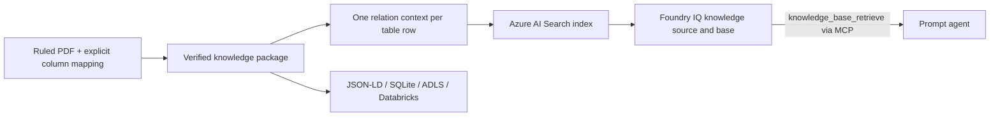

# Table relations → Foundry IQ → prompt agent

The adapter can give a prompt agent a complete explanation of each mapped table
row: entity labels, directed predicates, properties, missingness, and source-cell
evidence. `knowledge foundry` generates Azure AI Search documents and connection
configuration; `knowledge foundry-publish` applies it to explicitly selected,
existing Azure resources. No custom graph-query server is required.



This path uses Microsoft's [Search-index knowledge source](https://learn.microsoft.com/en-us/azure/search/agentic-knowledge-source-how-to-search-index)
and [native agent MCP connection](https://learn.microsoft.com/en-us/azure/foundry/agents/how-to/foundry-iq-connect).
It does not perform free-text entity discovery, cross-document entity resolution,
OWL reasoning, or transitive graph traversal. Column meanings come from the
caller's ontology mapping. See [table extraction and lakehouse storage](table-knowledge-lakehouse.md).

## Export and inspect locally

```bash
python -m pip install -e '.[tables,lakehouse,foundry]'
sr-adapt knowledge extract document.pdf \
  --mapping data/knowledge/project-ownership.json --out artifacts/my-knowledge
sr-adapt knowledge foundry artifacts/my-knowledge --out artifacts/my-foundry
```

For a ready local example, use the two recorded synthetic/Digital Agency bundles:

```bash
sr-adapt knowledge foundry \
  docs/validation/table-correspondence-2026-10-16/knowledge-examples/synthetic \
  docs/validation/table-correspondence-2026-10-16/knowledge-examples/roles \
  --out artifacts/foundry-example
```

The result contains eight row contexts retaining all 19 entity mentions, 11
relations, and three property observations. Each directed relation and
observation has its full `assertion_id` next to the readable statement. A search
document ID, entity ID, and assertion ID identify different things; the agent
instructions distinguish them. An unknown value stays unknown. A spanning cell
remains evidence for an ambiguous observation rather than becoming a filled-down
value. Missing entity observations name the affected source column.

| File | Purpose |
| --- | --- |
| `cards.json`, `search-documents.jsonl` | Row contexts with facts and physical-cell evidence |
| `search-index.json`, `search-upload.json` | Search schema, semantic configuration, and document batch |
| `knowledge-source.json`, `knowledge-base.json` | Snapshot-filtered source and minimal extractive retrieval |
| `prompt-agent.json`, `agent-instructions.txt` | Prompt definition with the native retrieval tool |
| `project-connection.json`, `deployment-plan.json` | Managed-identity connection and ordered REST requests |
| `retrieval-request.json` | Example query requesting references and source data |
| `sources/`, `target.json`, `manifest.json` | Source packages, public destination configuration, byte hashes |

```python
from sr_adapter.foundry import verify_foundry
manifest, files = verify_foundry("artifacts/foundry-example")
print(manifest["card_count"], manifest["snapshot_id"])
```

Verification checks both file hashes and regeneration from the original cells
and mapping. Export alone makes no cloud request. Without `--target`, destinations
remain explicit placeholders. Output directories must be new; a completed
manifest is written last. The first implementation supports one batch of at most
1,000 contexts / 12 MiB, with each context at most 64 KiB. Oversized inputs fail
without silent truncation or a partial export.

## Select the destination and publish

Copy [the target example](../data/knowledge/foundry-target.example.json) to a local
file and replace every example value. Supply an existing public-cloud Search
endpoint, a Foundry project endpoint and ARM resource ID for the same project,
an existing model deployment, and dedicated connection/agent names. Hub-based
projects and sovereign-cloud endpoints are not supported by this implementation.
Keep credentials out of that file.

The publisher uses `DefaultAzureCredential` (for example, an existing `az login`
session). The caller needs Search configuration and document-write permissions,
Foundry agent permissions, and ARM connection-write permission. The project needs
its managed identity and Search Index Data Reader access. Search semantic ranking
must be enabled. Roles and services are not provisioned by this command. Check
[Microsoft's current permission requirements](https://learn.microsoft.com/en-us/azure/foundry/agents/how-to/foundry-iq-connect#authentication-and-permissions)
in the chosen tenant.

```bash
sr-adapt knowledge foundry artifacts/my-knowledge \
  --target foundry-target.local.json --out artifacts/my-foundry-configured
sr-adapt knowledge foundry-publish artifacts/my-foundry-configured \
  --target foundry-target.local.json --receipt artifacts/foundry-publish.json --execute
```

Index/source/base names include a snapshot hash. Choose a new dedicated connection
name for a new snapshot; a connection already pointing elsewhere causes a
conflict. Existing matching configurations are read and verified. A different
configuration is never intentionally replaced. Search creation uses
`If-None-Match: *`; the ARM connection API does not provide the same documented
concurrency guarantee, so do not race another publisher for the connection name.
Each explicit publication uploads the same deterministic document IDs and creates
a new agent version. The resulting receipt pins that version.

The publisher reserves the receipt before authenticating, checks every Search
document acknowledgement (including HTTP 207 partial responses), and stops on a
conflict, partial failure, or pending provisioning. It never automatically retries
or rolls back earlier successful steps. A 4xx is a rejected operation; a transport
failure, malformed acknowledgement, or 5xx leaves the outcome `unknown`. Inspect
the per-operation receipts and service state before resubmitting, especially an
ambiguous agent creation. Error bodies and access tokens are not stored in receipts.

`configured` means configuration acknowledgements and readbacks succeeded. It does
not prove indexing visibility, managed-identity access from the agent, retrieval
coverage, citation delivery, or answer accuracy. Those are separate live checks.
No Azure deployment or retrieval was performed for the committed local validation.

## Ask through the configured agent

The [Responses API invocation](https://learn.microsoft.com/en-us/azure/foundry/agents/how-to/foundry-iq-connect#invoke-the-agent)
uses the version from the publication receipt. For example:

```python
import json
from pathlib import Path
import httpx
from azure.identity import DefaultAzureCredential

receipt = json.loads(Path("artifacts/foundry-publish.json").read_bytes())
assert receipt["status"] == "configured"
target = receipt["configured_target"]
with Path("artifacts/agent-response.json").open("x", encoding="utf-8") as output:
    with DefaultAzureCredential() as credential:
        token = credential.get_token("https://ai.azure.com/.default").token
        response = httpx.post(
            target["project_endpoint"] + "/openai/v1/responses",
            headers={"Authorization": "Bearer " + token},
            json={"agent": receipt["agent_reference"],
                  "input": "朝凪の主担当と副担当を区別し、資料名とページを添えて説明して。"},
            timeout=60,
        )
        response.raise_for_status()
        json.dump(response.json(), output, ensure_ascii=False, indent=2)
```

Inspect the saved MCP calls, results and native citation annotations, including
whether the relevant row and `sourceData` arrived. `retrieval-request.json` can
also be sent to the knowledge base's `/retrieve` endpoint to inspect Search
independently. If the agent receives only a snippet, missing evidence stays
missing. Search-index citations may link to the knowledge-base endpoint rather
than the source PDF; this bridge does not invent public document URLs.

The generated connection is shared within the project and uses the project's
identity. Original file ACLs and end-user identity filters are not imported. Use
a corpus authorized for that project's readers. A shared multi-tenant corpus
needs a separate document-permission design.

## Version and evidence boundaries

The handoff pins Search/MCP to `2026-08-01-preview`, agent definitions to `v1`, and
ARM connections to `2025-10-01-preview`. Do not substitute stable Search API
versions without migrating the schemas; Microsoft's [migration guide](https://learn.microsoft.com/en-us/azure/search/agentic-retrieval-how-to-migrate)
documents differences. Minimal extractive retrieval uses semantic search without
a knowledge-base planning model; the prompt agent still needs its model deployment.

The [local context probe](foundry-context-2026-10-16.md) compares identical
questions/model settings on normalized records and row contexts. It measures
answer content and assertion references separately, preserves the initial failed
reference results, and does not measure Foundry IQ retrieval or VLM accuracy.
