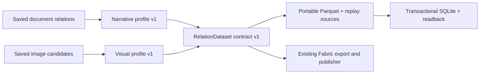

# Portable relation datasets

文書の読み取りと、接続先への保存を分ける共通層です。関係・根拠・出典・読み取り状態を
型付きの表にまとめ、同じ表をFabric、Parquet、ローカルSQLiteで利用します。
入力や接続先が増えても、両者の組合せごとに抽出処理を書き直す必要を減らします。

## Boundary

The first implementation moves the document and image relation projections out
of the Fabric connector. A source profile owns interpretation and evidence
layout; a sink owns serialization, destination configuration and write/readback
behavior. The dataset between them contains no destination credentials or load
URLs. Recorded extraction provenance, including a visual model's original
project endpoint, is retained as source data, never used to select a destination.



This layer normalizes the *handoff contract*, not every source into one ontology.
An explicit denial in a document and an uncertain connector in an image have
different meanings. Their profiles keep these distinctions. Do not union the two
`relations` schemas or turn `unknown`, `denied`, or `uncertain` into positive edges.
Endpoint/authentication setup remains a destination responsibility; business
vocabulary and ontology selection remain a source-profile responsibility.

## Contract v1

`relation_dataset.RelationDataset` is a frozen value containing a versioned
`profile`, distinct source `package_ids`, and `RelationTable` values. Each table
declares columns, scalar types, nullability and a primary key. Every row carries
its `package_id`. Strings, signed 64-bit integers, booleans and explicit nulls are
supported. Nested values, extra fields, type coercion, duplicate keys and unknown
source IDs fail validation instead of disappearing in a sink conversion.

The snapshot hash covers the contract version, profile version, selected packages,
schemas, primary keys and every row. Selection order and row order do not change
it. Changing a schema, source package, relation status or review does. Returned
row dictionaries are copies; consumers cannot mutate the shared dataset.
Structural validation is not semantic validation of a model reading.

| Profile | Tables | Meaning retained |
| --- | --- | --- |
| `narrative_relations/1` | documents, entities, relations, evidence, evidence_links, locations, limitations | Asserted/denied/unknown/ambiguous; null objects; literal-label matches; assertion-scoped mentions; full source context including uncited units; exact quotes through evidence links; scalar source locator paths |
| `visual_relations/1` | images, items, relations, evidence, limitations; optional reviews | Separate visual occurrences even for equal labels; direction, support, explicit quantities, normalized 0–1000 regions, source image identity; review findings alongside unmodified model readings |

The narrative profile accepts saved narrative bundles from text/Markdown, CSV,
DOCX, PPTX and image transcription. The visual profile accepts saved grounded or
direct image bundles. Both replay their existing extraction contracts locally.
No input document, image or saved response is sent to a provider during export.
Zero relations is valid: source context and typed empty tables still survive.
Source files in a portable bundle retain their original access sensitivity.

## Local use

Install the optional Parquet dependency:

```sh
pip install 'sr-unstructured-adapter[lakehouse]'

sr-adapt knowledge dataset /path/to/saved-docx-bundle \
  --profile narrative --out /path/to/new-dataset

sr-adapt knowledge dataset-sqlite /path/to/new-dataset \
  --database /path/to/relations.db
```

For image candidates, use `--profile visual` and optionally `--review findings.json`
with the existing visual-review format. Select 1–20 distinct bundles from one
profile. Mixed profiles fail explicitly. The source selection and portable export
are bounded to 64 MiB. Output directories must be new.

The directory contains:

```text
manifest.json              # completion marker, content hashes and contract
dataset.json               # source IDs, schemas, keys, row counts/digests
tables/<kind>.parquet      # scalar columns, including typed empty tables
sources/<package-hash>/... # original replayable source bundles
review.json                # optional visual review input
```

`verify_relation_dataset()` regenerates every table from the saved sources and
compares schemas and rows. Rehashing an edited Parquet file is insufficient to
pass. It rejects unknown profile/contract versions and incomplete snapshots.

SQLite uses `srd_<full-snapshot-hash>_<kind>` tables plus a
`sr_relation_datasets` catalog. The command returns exact table names and counts.
All tables and the catalog marker commit in one transaction. Each snapshot has
its own tables; other datasets and unrelated existing tables remain intact. A
repeat verifies every schema and row and inserts zero rows. Conflicting or
partially modified tables cause an error and rollback; no implicit repair or
overwrite is performed. Booleans are stored as checked SQLite integers, nulls as
SQL NULL, and strings without rewriting.

```python
import sqlite3
from sr_adapter.relation_dataset_store import (
    load_relation_dataset, verify_relation_dataset, write_dataset_sqlite,
)

dataset, sources = load_relation_dataset(["/path/to/saved-bundle"], profile="narrative")
for table in dataset.tables:
    print(table.name, table.describe())
    # A new sink consumes table.columns, table.primary_key and table.values.

verified = verify_relation_dataset("/path/to/new-dataset")
receipt = write_dataset_sqlite("/path/to/new-dataset", "/path/to/relations.db")
name = receipt["tables"]["relations"]["name"]  # generated name, not source text
with sqlite3.connect("/path/to/relations.db") as db:
    counts = db.execute(f'SELECT assertion_status, COUNT(*) FROM "{name}" '
                       'GROUP BY assertion_status').fetchall()
```

## Compatibility and next connectors

The existing Fabric narrative and visual commands use these same profiles.
Their legacy snapshot formula, column order, load-plan order, schemas and saved
bundle formats are retained. Their snapshot IDs intentionally differ from the
new destination-independent dataset ID. Existing publications require no rewrite.
The offline Fabric IQ blueprint also reads the shared visual schema.

This is the first migrated slice. Ruled-PDF knowledge packages, native PPTX
object/connector tables, and Foundry search cards keep their existing formats;
they are not silently converted into either of these two profiles. The existing
ADLS/Databricks commands still accept their original knowledge bundle format.
New dataset sinks for those services, search cards and graph stores remain future
work. No new cloud compatibility or extraction-accuracy result is claimed here.

To add a source family, define a versioned profile with source replay, scalar
schemas and identity/evidence rules, and test it through the existing sinks.
Keep old profile implementations available for saved bundle replay. To add a
destination, consume the shared tables and place endpoint, auth, physical table
mapping and transport behavior in the sink. Preserve all supported fields; if a
target cannot represent a required type or semantic field, report that limit
before writing. A semantic projection such as a search card or graph requires
its own explicit versioned mapping, not an implicit flattening of these tables.

Conformance tests cover negative/unknown claims, source context, same-label
identity separation, image regions and review findings, multi-package ordering,
Fabric/portable row and schema equivalence, replay after rehashed edits, SQLite
readback, repeat writes and rollback. These tests use synthetic sources and mock
responses only.
