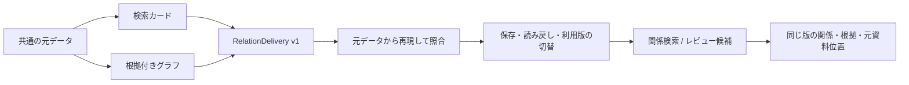

# Receiving and using relation datasets

検索カードとグラフを受け取り、元の根拠までたどって利用するための共通契約です。
接続先ごとの処理は、この契約を受け取る側に置きます。最初の実装はローカルSQLiteで、
文書と画像の両方に同じ受け取り・検索・追跡APIを使います。



## The receiver contract

`load_relation_delivery(search_bundle, graph_bundle)` loads two portable views
from [the search/graph projection](relation-views.md). Both must replay and refer
to the **same original source snapshot and source profile**. Two individually
valid views from different snapshots are rejected before the destination opens.

The immutable `RelationDelivery` contains the base `RelationDataset`, the search
dataset, the graph dataset and the original base-bundle bytes. Its constructor
replays the base sources and regenerates both views. `describe()` defines receiver
contract version 1, the source snapshot/profile and all three dataset descriptors;
`delivery_id` is their canonical SHA-256 hash. It has no endpoint or credential.
Original source bytes, model responses, source context and reviews remain data.
Replay establishes consistency with those inputs, not trusted authorship or the
semantic correctness of a model reading.

```python
from sr_adapter.relation_receiver import load_relation_delivery, SQLiteRelationReceiver

delivery = load_relation_delivery("./search-view", "./graph-view")
receiver = SQLiteRelationReceiver("./received.db")
receipt = receiver.receive(delivery, collection="systems")
assert receipt["status"] == "committed" and receipt["readback_verified"]
```

`RelationReceiver` is the Python protocol for this entry point. Implementing that
method signature alone is not conformance. A receiver must preserve the declared
scalar types, keys and semantic fields; reject unsupported profiles/capabilities
before activation; read back the full data; keep a durable source/evidence path;
and activate the paired views using an expected previous snapshot. A cloud sink
that stages multiple services must not report a committed pair merely because one
index write succeeded. That transport and its recovery/readback tests are still
future work; SQLite is the only receiver implementation in this change.

## Local publication and updates

```sh
pip install 'sr-unstructured-adapter[lakehouse]'

sr-adapt knowledge dataset-receive ./search-view ./graph-view \
  --database ./received.db --collection systems

# Use snapshot_id from the previous receipt or a current query.
sr-adapt knowledge dataset-receive ./new-search-view ./new-graph-view \
  --database ./received.db --collection systems --expected-snapshot <current-source-snapshot>
```

The receiver archives the replay inputs, saves the source/search/graph tables,
verifies exact readback, records collection membership and changes the active
snapshot **in one SQLite transaction**. A failed write or failed verification rolls
the transaction back. Other collections and previously received snapshots remain.
The receipt is returned after commit; `inserted_rows` counts dataset rows, excluding
archive/catalog rows. The existing `dataset-sqlite` command and physical
`srd_<snapshot>_<table>` names remain compatible.

Collections are explicit lowercase names. A collection represents a selected
source scope and one source profile. An update replaces its active **whole source
selection**, rather than appending one document to that selection. To add a document,
prepare a new base dataset with the desired complete selection. Narrative and
visual profiles use separate collections; applications may display their results
together without unioning their distinct source schemas or merging equal labels.

| Condition | Result |
| --- | --- |
| New collection, no expected snapshot | Complete delivery becomes active |
| Same delivery already active | Exact readback; no new dataset rows |
| New delivery and expected snapshot equals current | New delivery becomes active; previous version stays accessible |
| Missing/wrong expectation for a different active delivery | `ReceiverConflict`; active version stays unchanged |
| Delayed retry of an old delivery after an update | Conflict unless the caller explicitly supplies the new current snapshot |
| Explicit return to a prior delivery with current expectation | Intentional switch back; no deletion of other versions |
| Incompatible profile, corrupt archive/tables or partial catalog | Error; no automatic repair or semantic conversion |

Concurrent updates serialize under `BEGIN IMMEDIATE`; of two distinct updates
with the same expectation, at most one can activate. Equal snapshot IDs remain
safe to retry. Versioned snapshots are retained until an operator manages the
database; automatic retention/deletion is not implemented. A collection name is
a selection boundary, not user authentication or a tenant security boundary.

## Search, trace and review

```sh
sr-adapt knowledge dataset-query --database ./received.db --collection systems \
  --query '融資システム'

sr-adapt knowledge dataset-query --database ./received.db --collection systems \
  --assertion-status unknown

sr-adapt knowledge dataset-query --database ./received.db --collection diagrams \
  --support uncertain

sr-adapt knowledge dataset-query --database ./received.db --collection systems \
  --query '承認後' --scope context

sr-adapt knowledge dataset-trace <card_id> --database ./received.db \
  --collection systems --snapshot <snapshot_id-from-query>
```

`search_received_relations()` performs a literal, Unicode-casefolded substring
match on title, subject, predicate or object. It does not use SQL wildcard syntax,
embeddings, ranking or language-model inference. `--scope context` searches the
saved full source context instead; since cards retain that context, it may match
every card from one document. An empty query lists cards. Filters preserve explicit
denied/unknown/ambiguous statuses and visual support. An unknown claim has no
object; a denial does not turn into a positive relationship.

Results have deterministic package/card ordering, `total`, `offset`, `limit`
(1–100), `has_more`, the selected `snapshot_id` and current `active_snapshot_id`.
This is transparent paging, not relevance ranking. A package with zero relations
still has its source-context card; no relation is invented.

`trace_received_relation()` returns the exact card, source node, assertion,
endpoint mentions, ordered evidence, source locators, observed image occurrences,
related review findings and limitations. The card also keeps uncited source
conditions. Always pass the search response's snapshot to trace: after an update,
an old card will still resolve against its original version. Without that snapshot,
a stale card fails explicitly rather than resolving to a different assertion.
Image coordinates and observations survive; the original pixels remain in the
archived source bundle, not inline in the trace response.

Read APIs open the database read-only and use a consistent transaction. They
replay the retained inputs and compare every stored table before returning data.
They continue to work after deleting the original handoff directories, and reject
modified stored rows instead of serving or repairing them silently. This reference
implementation favors complete verification over large-corpus query throughput;
indexed retrieval, verified immutable caching and performance benchmarks are next
steps. Existing portable limits still apply: each input view is bounded at 64 MiB
and its base manifest at 1 MiB. Oversize views fail without truncating source data.

## Applications to pursue

The runnable fixture below checks plumbing using Japanese synthetic source text
and **handwritten extraction responses**. It does not measure model accuracy.

```sh
python scripts/demo_relation_receiver.py --out /path/to/new-local-demo
```

It creates two source revisions, complete bundles, `receiver.db`, a Japanese
README and `report.json` containing receipts, search hits and evidence traces.
It checks relation search → exact evidence, unknown/negative review queues,
uncited approval conditions, explicit version switching, historical evidence and
rejection of a delayed old delivery. No model or cloud call is made.

| Application | Useful result from this layer | Additional work for production use |
| --- | --- | --- |
| Agent / RAG evidence tool | Search hit → assertion state → same-version citations and locators | Expose bounded search/trace tools with access control; evaluate retrieval and answer quality |
| Requirements/document review | List unknown, ambiguous or uncertain candidates; inspect original evidence and annotations | Domain-specific review rules and human feedback; absence alone cannot prove a missing requirement |
| Change investigation | Read two explicit source versions and compare cited statements while preserving the old version | Explicit logical-document/identity mapping and a tested change matcher; equal labels are insufficient |
| Search service + graph store | Shared card/node/source IDs with a receiver-side activation contract | Target-specific staging, type/size preflight, readback and recovery; no live backend compatibility claimed yet |
| Lakehouse / SQL analytics | Scalar source and view tables, separate profile and snapshot identities | Dataset sink for the chosen database, controlled cross-source joins and retention |

The first useful next application is the **search/trace tool pair for an agent**:
the agent can retrieve candidates and their original evidence through the same
contract regardless of the eventual storage service. The review queue is also
usable now without an answering model. Entity resolution, business ontology rules
and cross-document impact reasoning need their own explicit layer and evaluation;
publication must not silently turn model candidates into certified facts.

## Validation boundary

Conformance tests cover both source profiles, mismatched view pairs, original
DOCX locators, image evidence/regions/reviews, negation and missing objects, empty
extractions, replay after input deletion, typed readback, retries, history,
interrupted transactions, concurrent updates, paging, literal search, CLI failure
messages and archive/table/catalog corruption. They use synthetic documents and
mock responses only. Receiving, extracting accurately, retrieval quality and
successfully connecting a live cloud service remain separate claims.
