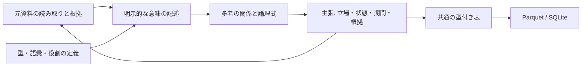

# Source-bound semantic overlays

共通の関係データに、型・階層・多者の役割・条件・例外・期間・解釈の違いを追加します。
元の読み取りを保ったまま、明示的な意味の記述を別の層に重ねる仕組みです。
接続先ごとにこの意味を作り直すことを減らし、同じ表を各保存先で扱えるようにします。

例えば、次の合成資料を表せます。

> 承認済み、かつ緊急停止中でない場合、審査部は申請Aを上限1,000万円で処理する義務がある。

「審査部」「申請A」「システム」「金額」「通貨」を一つの処理の役割として持ち、
`承認済み AND NOT 緊急停止 → 処理` の式を保存します。
その式への主張に「義務」「適用期間」「審査担当の解釈」を付けます。
監査担当の異論も別の主張として併存できます。
この記述から、申請Aが実際に承認済みだと決めることはありません。



## API and use

```python
from sr_adapter.relation_dataset_store import (
    verify_relation_dataset, export_relation_semantics, write_dataset_sqlite,
)
from sr_adapter.relation_semantics import project_relation_semantics, trace_semantic_claim

source = verify_relation_dataset("source-dataset")
# overlay is an explicit SemanticOverlay or a dictionary following its schema.
dataset = project_relation_semantics(source, overlay)
export_relation_semantics("source-dataset", "semantic-bundle", overlay=overlay)
receipt = write_dataset_sqlite("semantic-bundle", "semantics.db")
trace = trace_semantic_claim(source, overlay, claim_id="operations-reading")
```

The pure API accepts the existing `narrative_relations/1` or `visual_relations/1`
source. It validates source schemas/joins and exact snapshot references; use the
bundle loader for source replay. A source selection still contains one profile.
An overlay can explicitly reference several packages within that selection;
combining narrative and visual inputs in one selection remains unsupported.

The input is `SemanticOverlay` version **1**, output profile **`relation_semantics/1`**.
`SemanticOverlay.model_json_schema()` exposes its strict input schema. Unknown
fields, duplicate IDs, unresolved references and invalid forms are errors. IRIs
are identifiers only; the implementation never fetches them.

The standalone CLI uses the same exporter and verifier:

```sh
python -m sr_adapter.relation_semantics export \
  --source ./source-dataset --overlay ./overlay.json --out ./semantic-bundle
sr-adapt knowledge dataset-sqlite ./semantic-bundle --database ./semantics.db
python -m sr_adapter.relation_semantics trace \
  --bundle ./semantic-bundle --claim operations-reading
```

Run the complete synthetic example in a new directory:

```sh
python scripts/demo_relation_semantics.py --out /tmp/semantic-example
```

It writes the source package, editable `overlay.json`, portable `semantics/`,
`semantics.db`, and `report.json` with the readback and source trace. Its extraction
response and semantic declarations are handwritten fixtures. It measures no
automatic extraction accuracy, answer quality, or real bank rule correctness.

## Vocabulary, expressions, claims

The overlay includes `source_snapshot_id`, `author`, `description`, and these lists:

| Input | Meaning |
| --- | --- |
| `terms` | Absolute IRI, kind `class / relation / role / individual`, label, description. Labels never establish identity. |
| `axioms` | Explicit `subclass / subrelation / disjoint / equivalent / inverse` declarations between compatible kinds. These are not evaluated or expanded. `equivalent` supports classes/relations, not individual identity. |
| `roles` | Optional relation signatures: named roles, min/max occurrences, and permitted value kinds. Once a relation has a signature, its undeclared roles are rejected. |
| `expressions` | `atom`, `and`, `or`, `not`, `implies`. Atoms have a declared relation and ordered, named role arguments; logical operators have ordered expression IDs. |
| `claims` | A stance on a **whole expression**: status, modality, basis, attribution, free-text context, optional validity interval and ordered source citations. |
| `claim_links` | Explicit `supports / challenges / alternative_to / derived_from / qualifies` annotations between claims, with a note. They record the author's relation, not a proof or automatically detected conflict. |

Terms and all declarations are authored under the overlay's author/description;
they are not silently attributed to the input document or certified as true.
The prototype validates vocabulary kinds, cardinality and allowed value kinds.
It does not check membership of a source mention in a class, detect inconsistent
disjointness, materialize subclasses, resolve individual identity or run rules.
Class cycles are stored; recursive expression cycles are rejected.

An expression's `package_id` anchors its declaration. IDs are unique across the
overlay; source values can point to nodes from another explicitly selected package.
Table rows retain both owner and target package IDs for those cross-package links.
Atoms may repeat a role when allowed by its signature. Positions are zero-based;
argument order, duplicate arguments, operand order and duplicate operands survive.
There is no flattening of n-ary events into multiple binary business facts.

Each argument has one explicit value kind:

| Kind | Fields / interpretation |
| --- | --- |
| `source` | `node_id` from `project_relation_view(source, view="graph")`. References an exact occurrence/record, not a globally resolved entity. |
| `term` | `iri` of a declared symbol, including a class or individual. |
| `literal` | `lexical`, `datatype`, optional `language`; preserves lexical spelling and datatype. |
| `expression` | `expression_id`, allowing a proposition about another proposition without asserting the nested one. |
| `unknown` | Required `reason`; represents an unresolved argument, not a fabricated entity or a null literal. Include this kind explicitly in signatures that allow incomplete readings. |

Supported literal datatypes are XSD `string`, `boolean`, `integer`, `decimal`,
`date`, `dateTime`, and RDF `langString`. Integers/decimals remain lexical strings
so large values, `+000`, precision and trailing zeros survive SQL/Parquet without
floating-point rounding. Boolean lexical forms are `true / false / 1 / 0`.
`langString` requires a language tag; other datatypes prohibit one. Unknown
datatypes fail rather than being treated as strings. This implementation supports
the `YYYY-MM-DD` date subset and timezone-qualified dateTimes in years 0001–9999,
with up to six fractional-second digits and offsets within ±14:00. It does not
implement the entire XSD lexical space or validate language tags against a registry.

## Scope matters

For a minimal atom, an argument can be written as:

```json
{
  "id": "process",
  "package_id": "<selected-source-package-id>",
  "operator": "atom",
  "predicate": "urn:example:Process",
  "arguments": [
    {"role": "urn:example:actor", "value": {"kind": "source", "node_id": "<exact-source-graph-node-id>"}},
    {"role": "urn:example:ceiling", "value": {"kind": "literal", "lexical": "10000000.00", "datatype": "http://www.w3.org/2001/XMLSchema#decimal"}}
  ]
}
```

The script supplies a complete declaration with real source IDs. A condition and
exception use separate atoms combined into `and(approved, not(stopped))`, followed
by `implies(condition, process)`. `implies` stores antecedent at position 0 and
consequent at position 1. A claim references the entire expression; nested atoms
do not inherit its status or become standalone claims. Expressions can also exist
without any claim about them.

Claims preserve separate axes:

- `status`: `asserted / denied / unknown / ambiguous` describes the recorded stance.
- `modality`: `descriptive / required / permitted / prohibited / possible / hypothetical`
  qualifies the whole expression. No modal distribution or deontic inference occurs.
- `basis`: `source_interpretation` requires source citations; `hypothesis` can be
  uncited, but always remains marked as a hypothesis.
- `attributed_to` and `context` retain the speaker/viewpoint and scope as text;
  equal speaker labels do not resolve identity or grant authority.
- `valid_from / valid_until`: optional, timezone-qualified **half-open** interval
  `[from, until)`. A null endpoint is unspecified. Dates are validated and retained,
  not evaluated against the current clock or automatically applied to other claims.

`not(P)` is syntax inside an expression; `status=denied` records a stance on a whole
expression. They are not normalized into each other. Required, permitted and
prohibited readings are not reported as events that happened. Missing claims are
not denials. A `challenges` link does not select a winner or prove contradiction.
Negation, unknown objects, uncertain visual support and review records in the
underlying source remain unchanged, even when an overlay author proposes a
different interpretation.

## Tables and replay

All 11 output tables use ordinary scalar columns:

`overlays`, `terms`, `axioms`, `roles`, `role_kinds`, `expressions`, `operands`,
`arguments`, `claims`, `citations`, `claim_links`.

Every row includes `package_id`, `source_snapshot_id`, `source_profile` and
`overlay_id`. Vocabulary is repeated per selected source package to keep the
existing package-keyed dataset contract. Cross-reference columns preserve target
packages. Literal datatype/language/value, unknown reasons, temporal scopes and
modality are separate columns, not nested JSON strings. A connector must carry
these fields together; exporting just the predicate and two labels loses scope.

`overlay_id` hashes the normalized, complete declaration; `snapshot_id` hashes the
versioned tables. Reordering unordered declaration lists does not change either;
reordering arguments, citations or operands does. Author, context, notes and unused
declarations are retained and included in identity. This is content identity,
not a source-to-source entity identity algorithm or a signature.

The portable directory includes typed Parquet, `semantics.json`, the descriptor
and manifest, and the original base dataset under `input/`. Verification replays
that source, validates the declaration, rebuilds the semantic tables and compares
every schema and value. Editing output tables or only editing/rehashing the
declaration cannot pass replay. A deliberately rebuilt consistent declaration is
a **new** overlay; replay cannot certify its authorship or semantic correctness.

The existing SQLite sink provides transactional save, exact readback, repeat-write
verification and no implicit overwrite. A saved semantic overlay is not accepted
as a base source for another overlay or a legacy search/graph projection. Existing
receiver and agent tools continue to expose their source views; they do not
silently ingest or flatten this new profile. This version adds local semantic
export/trace and storage, not cloud registration or live agent integration.

`trace_semantic_claim` returns the selected claim, the connected component of
explicitly linked claims (including dissent), their full reachable expression
graphs, vocabulary, role declarations and original source records. It also keeps
**all** saved context for the relevant packages, including uncited document units,
DOCX locators, image observations/boxes, limitations and review findings. It does
not crop image pixels or parse new documents. The source and overlay text are
untrusted content, never instructions or permission to act.

Input is bounded to 4 MiB both before and after normalization; generated rows and
trace output to 64 MiB, and portable files to the existing 64 MiB bundle budget.
Expression depth is bounded to 64 and collection sizes have schema limits.
Oversized results fail without silent truncation or partial output. Trace follows
claim links with a visited set, so bidirectional disagreement is valid.

## Design references and next steps

The explicit n-ary relationship follows the general representation pattern in
[W3C's n-ary relations note](https://www.w3.org/TR/swbp-n-aryRelations/).
Separating reusable vocabulary from grounded claims also makes room for later
mappings to [OWL 2](https://www.w3.org/TR/owl2-primer/), provenance concepts from
[PROV-O](https://www.w3.org/TR/prov-o/), and validation shapes such as
[SHACL](https://www.w3.org/TR/shacl/). This profile is an adapter-specific interchange
contract; it does **not** implement or claim conformance to these standards.

Next useful slices are an extractor that proposes overlays for review, a
scope-preserving agent retrieval format, and explicit RDF/SHACL mappings. Each
needs its own validation. Quantifier binding, general variables, OWL entailment,
truth maintenance, cross-source entity resolution and temporal rule evaluation
remain future work. The current tests establish representation and readback,
not that an extracted interpretation is complete or correct.
