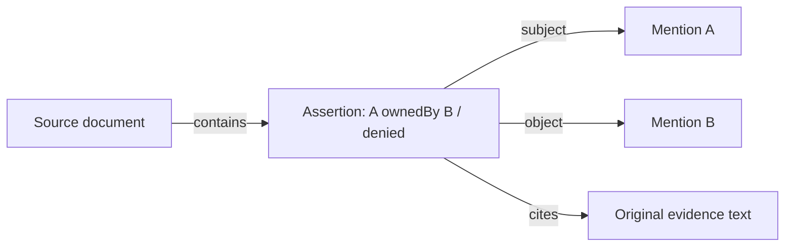

# Search cards and assertion graphs

共通データ層から、検索用カードとグラフ表現を生成します。検索結果から同じIDの関係を
たどり、元の根拠へ戻れます。文書・画像それぞれの解釈は共通側に残し、検索サービスや
グラフDBへの接続処理は、この表現を受け取って保存する役割になります。

## One dataset, two representations

`project_relation_view(dataset, view="search" | "graph")` consumes the immutable
`RelationDataset` introduced in [the portable dataset contract](relation-datasets.md).
It accepts `narrative_relations/1` and `visual_relations/1`, validates their exact
schemas and joins, and returns another typed scalar dataset. It does not parse
original source files, call a model, compute embeddings, choose a search service,
or infer entity identity. Source authenticity/replay is checked by the bundle
loader; validating an in-memory dataset alone does not certify its origin.

| View | Profile | Tables / convenience file |
| --- | --- | --- |
| Search | `relation_search/1` | `cards`; UTF-8 `cards.jsonl` with the same rows |
| Graph | `relation_graph/1` | `nodes`, `edges`, `properties` |

Both preserve `package_id`, `source_snapshot_id`, and `source_profile`. A search
card's `graph_node_id` identifies the corresponding assertion node in the graph
of the **same source snapshot**. Source table keys, not display labels, define
node identity. Equal labels across occurrences, documents, or assertions are
never automatically merged. IDs are deterministic within a snapshot; a changed
source selection or review changes its snapshot and the view IDs.

The [receiver contract](relation-receiver.md) now accepts both views as one
delivery, verifies their common source, and atomically activates a local collection.
Its search/trace APIs return the selected snapshot so evidence survives later updates.

## Search context

There is one card per extracted assertion. Titles retain the narrative status
or visual support/direction, so a negative or uncertain reading is not displayed
as an unqualified fact. Scalar metadata includes the assertion ID, predicate,
labels, source filename/hash, evidence count, literal-label matches, grounding,
review state and semantic-validation state. Profile-inapplicable values are null;
visual `support=uncertain` is not mapped to narrative `assertion_status=unknown`.

The content carries the exact candidate row, endpoint mentions and cited evidence
in source evidence order. Narrative cards include **all extracted source units**,
including uncited conditions, exceptions and scalar locator details. Visual cards
include the full saved model inventory, normalized regions, limitations and review
findings. They identify this as a model reading; image pixels remain in the saved
input bundle. Text inside sources and reviews is data, never instructions or
authority to act.

A package with zero assertions gets one `source_context` card, with no relation
ID or assertion status. This supports source discovery without fabricating an
edge or treating absence as a negative claim. Contexts never include another
package's text. Retrieval quality, ranking and model-answer quality are separate
evaluations, not established by exporting these cards.

## Graph semantics

The graph describes **source assertions**, including asserted, denied, unknown and
ambiguous claims. It never creates a direct business-predicate edge between two
entity mentions, even for a positive candidate. For example:



The arrows `subject` and `object` name assertion roles, not a real-world connection
or data-flow direction. Unknown/ambiguous narrative claims have no object node or
object-role edge. Visual `unspecified` and `bidirectional` directions stay on the
assertion; no reverse or transitive business edges are synthesized.

Every base table row has a node: source records, mentions, assertions, evidence,
evidence links, locator leaves, limitations and optional review findings. Node
properties retain **every original scalar field**. `properties` uses separate
`text_value`, `integer_value` and `boolean_value` columns plus `value_kind`; null,
false, zero and empty string remain distinct. Nodes include their source table and
hashed primary key. This is a lossless relational graph of the saved dataset, not
an ontology reasoner or a certified fact graph.

Edges use only structural roles: `contains`, `subject`, `object`, `cites`,
`assertion`, `evidence`, `observes`, `location`, and `reviews`. Citation edges carry
their order. Visual evidence connects to its original occurrence. Review findings
connect to the exact source, occurrence or assertion they reference; neither
negative findings nor unreviewed readings are discarded. All edges remain within
their source package.

## Export and inspect locally

Start with a verified base dataset from `knowledge dataset`:

```sh
sr-adapt knowledge dataset-view ./dataset --view search --out ./search-view
sr-adapt knowledge dataset-view ./dataset --view graph --out ./graph-view
sr-adapt knowledge dataset-sqlite ./search-view --database ./relations.db
sr-adapt knowledge dataset-sqlite ./graph-view --database ./relations.db
```

Each view contains its typed Parquet tables, `dataset.json`, a completion manifest
and the original base dataset under `input/`. Search additionally includes
`cards.jsonl`. `verify_relation_dataset()` regenerates the base dataset from the
enclosed original sources, then regenerates the view from that exact dataset.
Rehashing an edited status, edge, property or card does not bypass replay. An
unknown version or a view built from another view is rejected; derive both views
from the original dataset to retain shared identities.

The source and graph values are ordinary scalar Parquet/SQLite tables. A connector
can map graph nodes/edges/properties to its native representation without reading
DOCX, model response JSON or source-specific relation formats. To query a negative
search result's original evidence in the local database:

```python
import sqlite3
from sr_adapter.relation_dataset_store import write_dataset_sqlite

cards = write_dataset_sqlite("search-view", "relations.db")["tables"]["cards"]["name"]
graph = write_dataset_sqlite("graph-view", "relations.db")["tables"]
with sqlite3.connect("relations.db") as db:
    rows = db.execute(f'''SELECT c.title, p.text_value
        FROM "{cards}" c
        JOIN "{graph['edges']['name']}" e ON c.graph_node_id=e.source_id AND e.role='cites'
        JOIN "{graph['properties']['name']}" p ON e.target_id=p.node_id AND p.property_name='text'
        WHERE c.assertion_status='denied'
        ORDER BY c.card_id, e.position''').fetchall()
```

The table names above come from the sink's receipt, not from source text. SQLite
uses the same atomic commit, repeat-readback and no-overwrite behavior as base
datasets. No database server, credentials, endpoint or network call is required.

## Limits and versioning

Each view has a 64 MiB serialized-row budget; the complete saved bundle also has
the existing 64 MiB file budget. If full contexts exceed a limit, generation fails
before creating the output directory. Evidence is never silently truncated. A
destination with a smaller document/token limit must preflight that limit or use
a separately specified, source-preserving context strategy. Search cards include
full context by design; this version does not introduce chunking or embeddings.

The new projections leave existing source, Fabric, Foundry and base-dataset
formats intact. Foundry search cards continue to use their existing format; live
search services and graph databases are not configured by these commands. A
future projection change must get its own profile version while keeping the v1
renderer for saved view replay. Tests exercise both source profiles, SQL traversal
from search hits to evidence, all four narrative statuses, visual uncertainty and
reviews, scalar reconstruction, source separation and tamper rejection.
