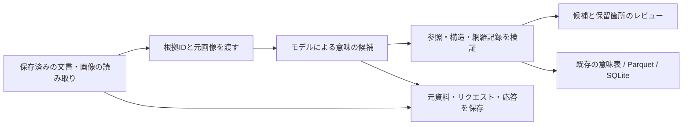

# Automatic semantic proposals

文書・画像の共通データから、条件・役割・義務・否定・期間・解釈の違いを持つ
[意味の記述](relation-semantics.md)をモデルに提案させます。画像では元の画像も渡します。
提案した各主張を原文・観測箇所へ結び付け、未確認の候補として保存します。



## What this stage does

This is the next stage **after source extraction**. Input is a replayable portable
base dataset (`narrative_relations/1` or `visual_relations/1`), produced by the
existing `knowledge dataset` path. Narrative sources can originate from text,
Markdown, CSV, DOCX, PPTX or image transcription. The visual profile keeps image
observations and regions. This command does not replace those extractors or take
an arbitrary raw DOCX directly.

The model proposes vocabulary, n-ary expressions, scoped claims and explicit claim
links. Original source readings stay intact. Nested conditions do not become
standalone facts. A proposed claim cannot declare itself human-approved or replace
the source snapshot: the host supplies source identity and the model-candidate
author after resolving exact references.

Every saved text unit or visual observation gets a model-reported disposition:

| Disposition | Meaning |
| --- | --- |
| `represented` | Names one or more candidate claims that cite this unit. |
| `context_only` | Kept as source context without a claim mapping. |
| `unresolved` | Has an explanation of what remains unclear; can also reference citing claims. |

Coverage entries must account for every unit exactly once. An empty visual
inventory gets a source-level entry even in a mixed selection with nonempty
packages. This is **accounting over the saved units**, not proof of completeness,
correctness or image pixel coverage. The model can misclassify an omission as
context, associate a wrong citation, or misinterpret a condition. The full saved
source remains available for inspection.

## Run and review

The Parquet dependency is provided by the `lakehouse` extra. Prepare without a
key or network request:

```sh
python -m sr_adapter.semantic_proposal_runtime propose ./source-dataset \
  --model gpt-5.5 --out ./proposal-plan
```

Inspect `request.json` and the archived input. To execute, use a **new** directory
and the existing `OPENAI_API_KEY` environment variable:

```sh
python -m sr_adapter.semantic_proposal_runtime propose ./source-dataset \
  --model gpt-5.5 --out ./proposal-run --execute
```

The runtime makes one bounded Responses call to `https://api.openai.com/v1/responses`
with `store=false`, no redirects and no retries. It does not read other repositories'
env files, provision keys, fall back to another provider/model, register data in a
cloud service, or activate a receiver collection. Applications can pass their own
key in memory. No credential is serialized into the request or configuration.
`OPENAI_BASE_URL` is not used by this runtime; external adapters can use the pure
request builder/importer described below.

A completed run contains:

```text
receipt.json            # prepared/running/complete/failed/unknown, stage, counts
request.json            # complete request saved before the call
response.json           # wire response, including failures when available
input/                  # exact archived source dataset
bundle/                 # only after successful structural validation
  manifest.json
  config.json
  request.json
  response.json
  bindings.json         # short model aliases -> exact source graph nodes
  proposal.json         # parsed model proposal with short aliases
  overlay.json          # resolved SemanticOverlay, when claims exist
  review.json
  review.md             # human-readable claim/expression/coverage tables
  input/
  semantics/            # standard relation_semantics/1 bundle, when claims exist
```

Open `bundle/review.md`, inspect conditions and exceptions in each complete
expression, then check its citations against the original source. All candidates
remain `unreviewed`, regardless of whether their references/structure validate.
The review report does not approve, apply, close or rank them automatically.

```sh
python -m sr_adapter.semantic_proposal_runtime verify ./proposal-run/bundle
python -m sr_adapter.relation_semantics trace \
  --bundle ./proposal-run/bundle/semantics --claim <claim-id>
sr-adapt knowledge dataset-sqlite ./proposal-run/bundle/semantics \
  --database ./semantics.db
```

An explicit `overlay=null` is a valid abstention. It saves coverage, unresolved
notes and response provenance, with `proposal_status=abstained`, zero claims and
no `semantics/` directory. It does not manufacture an empty assertion or report
missing claims as false. A complete receipt establishes a completed, structurally
valid proposal exchange; it is not a measure of extraction accuracy.

## Reference and scope validation

`proposal_context(dataset)` generates deterministic package aliases (`p1`, …)
and source-record aliases (`s1`, …). Each record maps to the same snapshot-scoped
graph ID used by the source views. Model outputs can use only these aliases.
Labels, filenames or arbitrary IDs cannot substitute for the mapping. Coverage
and claim evidence refer to original text units/visual observations, not merely
an entity label, model-written paraphrase or a nonexistent fragment.

Every claim has `basis=source_interpretation` with original citations. All
declarations remain hypotheses in the everyday sense of unreviewed model output;
this runtime does not permit uncited `basis=hypothesis` claims to bypass grounding.
The broader hand-authored semantic layer still supports that basis explicitly.

The semantic layer validates vocabulary/role kinds, arity, role cardinality,
typed lexical values, references, depth, cycles and validity intervals. This
runtime additionally checks source aliases and coverage associations. It does
not infer whether a cited sentence logically entails a claim. For example,
`not required` must be distinguished from `prohibited`; preserving a valid enum
is insufficient to establish that the model made the distinction correctly.

Full source context is included: uncited conditions, DOCX locators/header context,
image regions, limitations and saved reviews. Original image bytes are included
as `input_image` parts and verified against their saved hashes. No new images,
remote image URLs, arbitrary tools, OCR fetches or web lookups are used. An image
observation can itself be wrong. Newly noticed regions that lack a source anchor
must be reported as omissions rather than invented aliases; refining the visual
inventory is a separate pass.

Structured output uses the documented [Responses structured-output contract](https://developers.openai.com/api/docs/guides/structured-outputs)
and [image-input format](https://developers.openai.com/api/docs/guides/images-vision).
The wire schema requires every object property, prohibits extras and uses `anyOf`
for nullable/variant values. Complete local constraints are reapplied on receipt.
Sources, review comments and model-written notes remain data, never instructions
or permission to act.

## Replay and failures

`verify_semantic_proposal` replays the archived base dataset, rebuilds the complete
request including original pixels and schema, reparses the saved complete response,
resolves aliases and regenerates coverage, review text and semantic tables. It
compares every saved byte/descriptor. Rehashing an edited request, response,
resolved overlay, source mapping or approval flag does not bypass replay.
A consistently rebuilt new proposal is a new artifact; replay is not a signature
or an independent authentication of the model invocation.

Receipts distinguish source/request preparation, submitting, response receipt,
validation and saving. Failed/refused/incomplete responses never get a successful
proposal manifest. The original response is retained for diagnosis. Network or
filesystem uncertainty is marked `unknown`; the runtime never automatically
resubmits a possibly completed request.

Provider quota exhaustion is separately reported as `provider_quota_exhausted`,
including safe error identifiers such as `credit_balance_exhausted`. Ordinary
HTTP 429 rate limiting is `provider_rate_limited`; missing credentials and failed
authentication are also explicit. Raw exception text is not printed into the
receipt. The CLI exits nonzero on failures; it does not leave a silent empty answer.

Limits: 1 MiB serialized source context, 32 MiB complete request, 8 MiB response,
64 MiB portable proposal bundle, plus the underlying source/semantic limits.
The default output-token budget is 24,000 (configurable 1,024–32,000). Limits fail
without truncating a supposedly successful result. A locally oversized response
is saved as a bounded `.partial` file, explicitly marked truncated, without a bundle.
Output directories must be new; existing runs are never overwritten or resumed.

## Pure APIs and synthetic probe

```python
from sr_adapter.semantic_proposals import (
    proposal_context, proposal_request, resolve_proposal,
    import_semantic_proposal, verify_semantic_proposal,
)
from sr_adapter.semantic_proposal_runtime import propose_semantics

# `inputs` is the archived base dataset file mapping, including manifest.json.
request = proposal_request(inputs, model="gpt-5.5")
# An external Responses-compatible adapter can obtain `raw_response`.
import_semantic_proposal("source-dataset", "new-proposal", model="gpt-5.5",
                         response=raw_response)
```

`scripts/probe_semantic_proposals.py` creates synthetic Japanese DOCX and PNG
fixtures covering a conditional obligation, stop exception, exact monetary
ceiling, not-required versus prohibited, an unknown owner, unspecified timezone,
dissent and a quoted instruction that must remain source data. It freezes source
hashes and expected review criteria before any call. The underlying input readings
are handwritten fixtures, not an extraction benchmark. The image case includes
both original pixels and a handwritten inventory; it is not a raw-VLM comparison.

```sh
python scripts/probe_semantic_proposals.py --out ./new-probe \
  --font /path/to/a/Japanese-font.ttf --model gpt-5.5
# Add --execute, using a fresh output directory, for one model call per format.
```

Unit tests mock the provider and cover both source profiles, alias/coverage
validation, scope retention, abstention, byte limits, replay after rehashed edits,
SQLite readback/repeat writes, no-retry failures, explicit quota diagnosis and
secret-free request/receipt output. Live model observations must be reported
separately from those contract tests and from actual accuracy evaluation.

The [2026-10-28 synthetic observation](semantic-proposals-2026-10-28.md) records two
completed GPT-5.5 responses, retained quota failures, and concrete interpretation
gaps. It does not turn the model's coverage count into an accuracy score.
