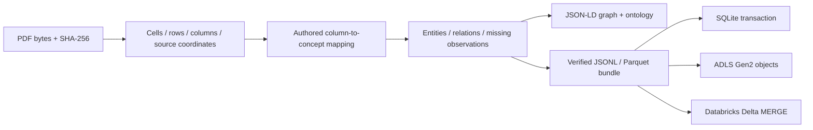

# Tables, grounded knowledge, and storage

`sr-adapt knowledge` adds an opt-in path from ruled PDF tables to source-scoped
entity mentions, relations, an explicit ontology, and storage. The ordinary
`convert` parser remains compatible. The knowledge path makes no model calls.



## Local end-to-end use

```bash
pip install '.[tables,lakehouse]'
sr-adapt knowledge extract example.pdf \
  --mapping data/knowledge/project-ownership.json \
  --out artifacts/knowledge/example --parquet
sr-adapt knowledge sqlite artifacts/knowledge/example \
  --database artifacts/knowledge/knowledge.sqlite3
```

The sample mapping expects `案件`, `主担当`, `副担当`, and `予算(万円)` headers. It
defines Project/Organization classes, managedBy/supportedBy relations, and a
budgetManYen property. Change the mapping to describe the actual document. The
second example, `data/knowledge/digital-agency-roles.json`, represents positions
and their exact role-description cells; it does not split prose into inferred
responsibilities or people.

Mapping and bundle files use UTF-8. CLI result JSON escapes non-ASCII characters
so it remains valid on legacy Windows consoles; decoding JSON restores the same
Unicode values without information loss.

The Python API exposes `extract_pdf_tables`, `extract_knowledge`, `OntologyMapping`,
and `KnowledgePackage`. `sr_adapter.tables.table_blocks` also converts extracted
tables to ordinary adapter Blocks for downstream callers. JSON schemas are
available with `sr-adapt schema table-document`, `schema ontology-mapping`, and
`schema knowledge`.

## Meaning and provenance

- Physical table cells retain raw text, row/column indices, row/column spans,
  page number (one-based), and PDF point coordinates measured from the top left.
  Ordinary Block provenance uses zero-based pages, and the bridge converts them.
  Detection uses pdfplumber's line-based grid heuristics; coordinates describe
  source geometry, while the interpretation as a table remains an extraction.
- PDF hashing and extraction use the same byte snapshot. The package records the
  original filename and SHA-256. Store the original PDF under that hash in your
  own source repository; the bundle does not copy the original PDF or its images.
- Entities are **row-scoped mentions**. Two identical labels in different rows
  are separate nodes. There is no implicit cross-document identity resolution or
  `owl:sameAs` inference. Relation types come from the authored mapping, and each
  assertion carries the contributing header and value cell IDs.
- Header matching tolerates Unicode compatibility forms and whitespace; duplicate
  normalized headers are ambiguous. Missing required headers skip that table with
  a warning. Spanning data cells are preserved but never filled down into invented
  row assignments. Unknown/ambiguous observations remain in the package without
  asserted literal values or invented entities.
- Property values remain source strings. Units are defined by the selected header
  and mapping; no unrequested numeric coercion, unit conversion, or summary occurs.
- `ontology.jsonld` declares configured OWL classes/properties with RDFS domain and
  range. `graph.jsonld` emits instance relations and PROV-linked evidence. These are
  JSON-LD representations of the authored mapping, not automatic ontology discovery,
  an OWL consistency proof, or validated open-domain NER.

Current extraction covers ruled, text-bearing PDFs. Image-only and unruled tables
may produce no detections; no OCR is performed. No detections are reported as
warnings and zero records of the affected kinds, not as successful semantic
extraction. Merged headers, cross-page table continuation, prose relation extraction,
and global entity resolution need separate, controlled extensions.

## Bundle and SQLite contract

An output directory is reserved exclusively. `package.json`, `graph.jsonld`,
`ontology.jsonld`, `records.jsonl`, and optional `records.parquet` are written before
the final `manifest.json` completion marker. The manifest records file sizes,
hashes, package identity, and record count. A failed export cannot silently replace
an existing directory. Sinks verify hashes, reconstruct the mapping, and compare
JSONL/Parquet/JSON-LD representations before writing.

JSONL and Parquet have four string columns:

| Column | Meaning |
| --- | --- |
| package_id | Content-derived version of the entire extracted package |
| kind | document, ontology, table, cell, entity, relation, observation |
| record_id | Stable identifier within the package |
| payload_json | Full typed record, including evidence and missingness |

This is a portable records layer. Spark, SQL views, and other DB adapters can
project typed business tables from it. New document versions get new package IDs;
previous versions are retained. SQLite uses one transaction and a composite
primary key. Repeating the same package inserts zero rows; conflicting stored
content aborts the transaction.

Example SQLite query after loading a bundle:

```sql
SELECT json_extract(s.payload_json, '$.label') AS subject,
       json_extract(r.payload_json, '$.predicate') AS predicate,
       json_extract(o.payload_json, '$.label') AS object
FROM sr_knowledge_records r
JOIN sr_knowledge_records s
  ON s.package_id = r.package_id
 AND s.record_id = json_extract(r.payload_json, '$.subject')
JOIN sr_knowledge_records o
  ON o.package_id = r.package_id
 AND o.record_id = json_extract(r.payload_json, '$.object')
WHERE r.kind = 'relation';
```

## Azure Data Lake Storage Gen2

```bash
pip install '.[tables,lakehouse,azure]'
# Configure DefaultAzureCredential, for example through your existing Azure login.
sr-adapt knowledge adls artifacts/knowledge/example \
  --account-url https://YOUR_ACCOUNT.dfs.core.windows.net \
  --filesystem YOUR_FILESYSTEM --prefix knowledge/v1 \
  --receipt artifacts/knowledge/adls-attempt-01.json --execute
```

The destination filesystem must exist. The uploader creates directories under the
selected prefix and writes `<prefix>/<package hash>/...`, publishing the manifest
last. Existing identical bytes are verified; different bytes are never overwritten.
The Azure SDK transport retry count is zero. Receipts list individual file outcomes;
an interrupted upload can leave partial objects, which are not a committed bundle.
After inspecting a failed attempt, a new receipt may reconcile existing objects by
byte comparison. Reusing a receipt is rejected. Use versioned prefixes if re-exporting
the same semantic package with a different Parquet encoding/library version.

ADLS is an object-storage destination. Uploading these files does not by itself
create a Fabric Lakehouse, Synapse schema, or Delta table. Those services can ingest
the verified Parquet records through their configured storage access.

## Databricks SQL / Delta

```bash
# Planning is local and does not need a token. Use your actual catalog/schema/table.
sr-adapt knowledge databricks artifacts/knowledge/example \
  --table CATALOG.SCHEMA.RECORDS --warehouse-id WAREHOUSE_ID
```

The plan contains `required_table_ddl` and a parameterized MERGE request. Provision
the four-string-column Delta table using that DDL in the intended workspace first.
Then configure `DATABRICKS_HOST`, `DATABRICKS_WAREHOUSE_ID`, and `DATABRICKS_TOKEN`
through the environment and execute:

```bash
sr-adapt knowledge databricks artifacts/knowledge/example \
  --table CATALOG.SCHEMA.RECORDS \
  --receipt artifacts/knowledge/databricks-attempt-01.json --execute
sr-adapt knowledge databricks-status \
  --receipt artifacts/knowledge/databricks-attempt-01.json
```

One MERGE submits all records using bound string parameters, not source text
interpolated into SQL. Identifiers are restricted to `catalog.schema.table`.
Matching immutable content is left intact; conflicting content raises an error.
Use a single writer per package: this is not a claim of distributed exactly-once
delivery or an enforced Delta uniqueness constraint. Batches above 4 MiB use the
Parquet/ADLS route instead.

The HTTP receipt is reserved before dispatch. A pending statement returns a
nonzero CLI status and retains its statement ID. Status lookup only performs GET;
it never resubmits the MERGE. An ambiguous timeout without an ID remains `unknown`
and must be reconciled in the workspace. `SUCCEEDED` alone is treated as committed;
HTTP 200, `PENDING`, or an unfamiliar state does not count as a completed write.
The connector does not provision catalogs, credentials, warehouses, or tables.

Cloud authentication, runtime-specific SQL execution, ACLs, and actual writes
remain unverified until exercised against a configured destination. Offline tests
cover SDK/API contracts, conflicts, partial writes, pending states, and no-retry
behavior. Local SQLite and Parquet are exercised with real files and queries.

## Controlled table comparison

`data/vlm_benchmark/table-correspondence-v1.json` fixes three synthetic pairs:
column permutation, header-only swapping, and row permutation, plus two existing
Digital Agency documents. Its 60 questions separate 12 value-recognition probes,
36 synthetic association probes, and 12 real-document questions.

The opt-in `prepare --pdf-tables` flag adds `vision_tables` to the original three
arms. It supplies extracted cells/coordinates, while images, questions, model,
system prompt, and output budget remain shared. This fourth arm uses table data
as its supplemental representation; it does not append gold or an ontology mapping.
Eight case groups balance each arm into each request position twice. Input-token
budgets differ by representation. A single repeat is a development probe, not a
statistical estimate. Source-quote matching retains the earlier narrow, uncalibrated
lexical metric and must not be presented as citation quality.

See the [observed run and local storage demonstration](table-knowledge-2026-10-16.md).

Implementation references: [pdfplumber table extraction](https://github.com/jsvine/pdfplumber#extracting-tables),
[JSON-LD 1.1](https://www.w3.org/TR/json-ld11/),
[Azure Data Lake Python](https://learn.microsoft.com/en-us/azure/storage/blobs/data-lake-storage-directory-file-acl-python),
[Databricks statement execution](https://docs.databricks.com/api/statement-execution/v1/execute-statement),
and [Databricks raise_error](https://docs.databricks.com/aws/en/sql/language-manual/functions/raise_error).
